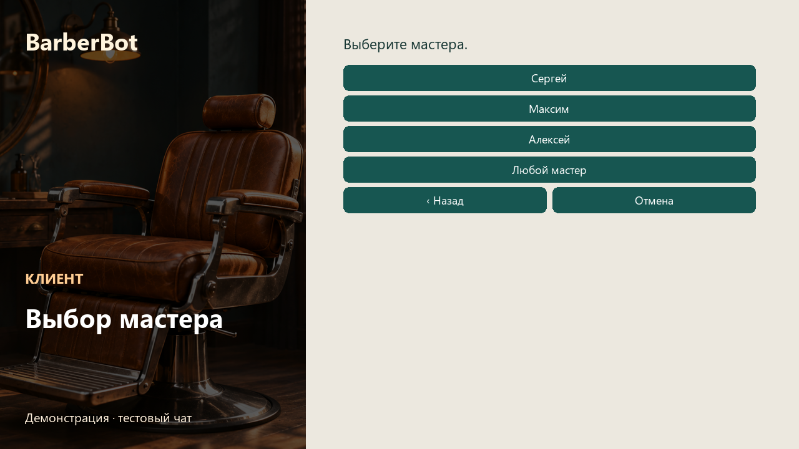
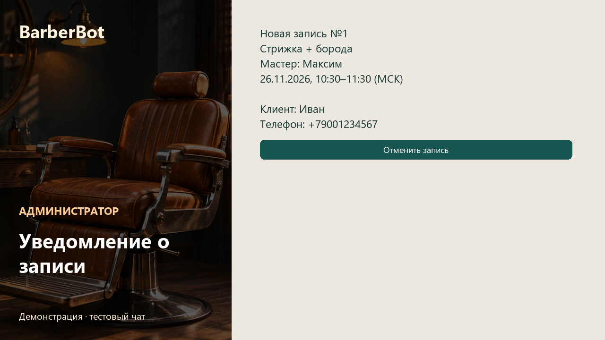
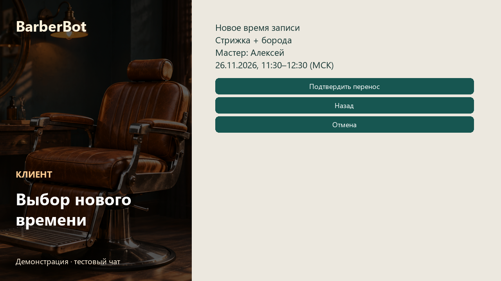
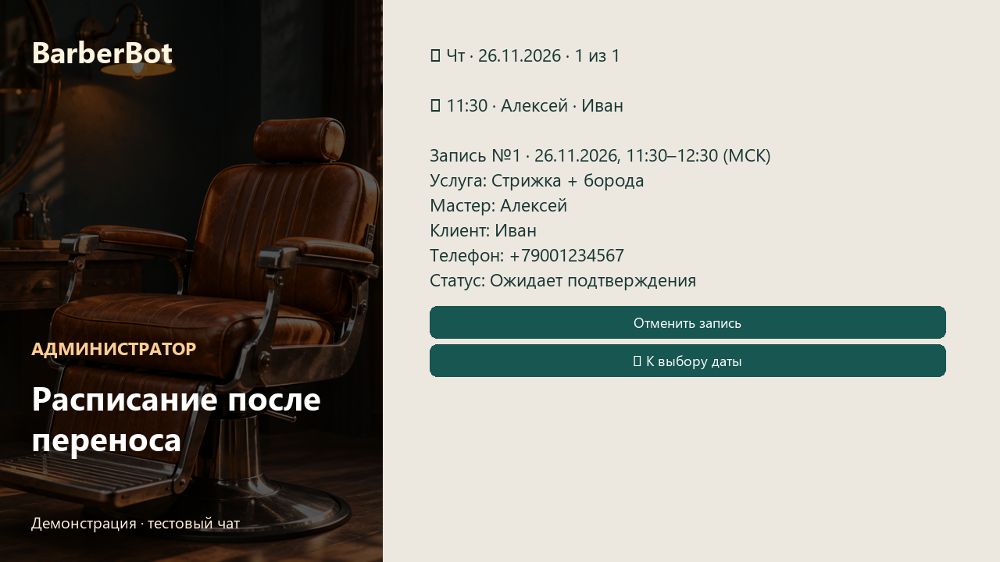

# BarberBot

## Задача

Разработать демонстрационного Telegram-бота, который позволяет клиенту самостоятельно выбрать время визита к барберу.

## Проблема до внедрения

В сценарии с записью через переписку администратор вручную проверяет свободное время, согласует визит и уточняет контактные данные. Один и тот же слот могут одновременно запросить несколько клиентов.

## Решение

Клиент выбирает услугу и мастера, видит доступное время и подтверждает запись в Telegram. SQLite хранит бронь и историю отмен. Транзакция проверяет весь интервал визита и исключает пересечения у одного мастера.

## Основные функции

- Календарь трёх мастеров на семь дней со стартами каждые 30 минут, учётом длительности услуги, смен и перерывов. Клиент может выбрать любого свободного мастера.
- Подтверждение записи, уведомление администратора и напоминание клиенту.
- Просмотр, подтверждение, перенос и отмена записи. Клиент может открыть перенос из напоминания.
- Просмотр записей на сегодня, пополнение каталога, управление графиками и оформление телефонных записей через панель администратора.

## Технологии

Python, aiogram, SQLAlchemy async, SQLite, APScheduler и pytest.

## Результат для бизнеса

На демонстрации можно показать путь клиента от выбора услуги до подтверждения, а также управление расписанием со стороны администратора. Для барбершопа такой сценарий мог бы сократить число сообщений для согласования визита. Проект создан для портфолио. Измерений на реальных клиентах не проводилось.

## Демонстрация записи и переноса

[Посмотреть минутный ролик](demo/barberbot.mp4)

Клиент записывается к Максиму на 10:30, затем переносит визит к Алексею на 11:30. В конце исходное время снова доступно. Кадры собраны из ответов бота на тестовых данных. Обе роли воспроизведены локально.

[QR-карточка бота](qr-card.png)

## Разовый выходной

В разделе «Графики мастеров» администратор выбирает мастера и отмечает выходной на конкретную дату. Новые записи на этот день закрываются. Уже назначенные визиты сохраняются, чтобы администратор мог согласовать перенос с клиентами.
